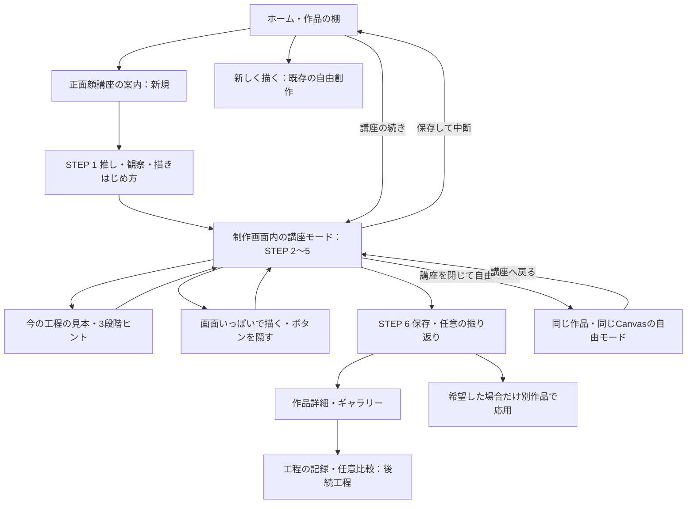

# 正面顔講座の設計案と現行アプリの照合

作成日：2026-10-29。照合した実装：`bd0c552`。状態：**設計レビュー用・講座は未実装**。

今回共有された企画を、既存の「すきのスケッチ」へどうつなぐかを整理する。ゼロから作り直す計画ではない。今回の変更は文書のみで、画面・保存形式・依存関係・通信は変更しない。

## 1. 記述の区分と適用範囲

| 区分     | 意味                                                                 |
| -------- | -------------------------------------------------------------------- |
| 指定     | ユーザーが示した目的・方針・要件。実装済みという意味ではない         |
| 実装確認 | 現行コードで確認した事実。今回のブラウザー操作や実機検証を意味しない |
| 仮説     | 体験を良くすると考えるが、初心者による検証が必要な考え               |
| 提案     | Codexからの設計案。採用が確定したという意味ではない                  |
| 要判断   | 実装前、または該当工程の前に選択が必要な事項                         |

**指定**：設計を先に確認できる状態にし、全機能の実装へ進まない。以下の提案や仮の名称・ルート・データ構造は、実装開始やAI導入の承認として扱わない。現行機能は[製品仕様](PRODUCT_SPEC.md)・[画面遷移](SCREEN_FLOW.md)、計画は[講座実装計画](COURSE_IMPLEMENTATION_PLAN.md)、検証は[講座テスト計画](COURSE_TEST_PLAN.md)を参照する。

## 2. 製品定義

**指定**：初心者が、好きな人型のアニメ・漫画調キャラクターの正面顔を自分の手で描き、楽しさ・発見・自分なりの成果に出会える日本語Webアプリ。上達や「描けるものが増える経験」も楽しさを支えるが、正確さや他人との比較を目的にしない。

最初の講座は正面顔1本。ユーザーが指定した5原則は「結果が見える」「発見がある」「実際の創作に使う」「迷いにくい」「本人が選べる」。講座の選択・中断・ヒント・振り返り・作品公開を強制しない。課題ができないことを理由に次の工程や自由創作を禁止しない。

**提案**：現在の自由創作を残し、希望したときだけ入れる短い講座を加える。非人型・横顔・複雑な画風は最初の教材の対象外とするが、自由創作では引き続き描ける。講座のために既存作品のサイズ・線・下絵・レイヤーを自動変更しない。

**仮説**：次の行動が一つ分かり、好きな特徴を一つ表現できると、白紙や教材選びの負担が減る。トレースから補助を少なくする試みが、別の表現へ移る足場になる。ただし、指描きの困難さが教材だけで解消するとは限らない。本人が「楽しくなかった」と感じた場合も検証結果として扱う。

## 3. 企画と実装の対応

以下はコードの確認結果。過去のテスト記録と、今回の確認を区別する。講座全体や初心者への学習効果を検証済みとはしない。

| 企画の要件                 | 現在の状態                                                                           | 講座のために必要な差分                            |
| -------------------------- | ------------------------------------------------------------------------------------ | ------------------------------------------------- |
| 推し・参考画像・特徴の記録 | 実装確認：複数の推し、任意画像、メモ、選択・編集                                     | 今回注目する特徴一つを、講座の記録として残す      |
| 自分で描く・画像を取り込む | 実装確認：Canvas、ペン・消去・取消、取込は別作品                                     | 講座と作品を関連付ける。取込時の継続先を明示する  |
| スマホで描く支援           | 実装確認：下絵、5方向のあたり、任意の最大5レイヤー、拡縮回転、専用画面、ボタン非表示 | 講座の説明でキャンバスが再び狭くならない配置      |
| 作品ごとの形               | 実装確認：1:1・3:4・4:3・参考画像の比率、長辺960px                                   | 正面顔講座でも選択を維持。正方形へ強制しない      |
| 工程別の説明・お手本       | 部分実装：基礎5・応用3の独立したヒントと図解                                         | 正面顔6工程をつなぐ教材、髪・パーツ・応用課題など |
| 段階別ヒント               | 未実装：基礎／応用は分類で、支援の3段階ではない                                      | 短いきっかけ→具体説明→手順への分解を任意に開く    |
| 講座の中断・再開           | 部分実装：作品と道具は保存再開できる                                                 | 現在の工程・教材版・観察メモを保存する            |
| 工程ごとの結果保存         | 未実装：自動保存は最新の作品を更新する                                               | 過去工程を見返すための独立した記録                |
| ギャラリー・PNG・振り返り  | 実装確認：途中作品、出力、任意の1問、否定的回答、スキップ                            | 講座由来の作品や記録を見返す導線を追加する        |
| 過去作品との任意比較       | 部分実装：振り返りの比較質問で過去作品を表示                                         | 工程同士の比較や、専用の比較画面はない            |
| AIの質問対応               | 未実装：現在は固定教材・固定質問。外部AI通信なし                                     | 導入自体が要判断。固定応答をAIと表示しない        |
| 任意の外部共有             | 実装確認：PNG取得、対応端末では共有API                                               | OSの共有先は本人が選ぶ。アプリ内SNSは追加しない   |

主な照合先：推しは`src/features/characters/`、制作は`src/features/drawing/`、ヒントは`src/features/hints/`、比較は`src/features/reflections/ReflectionSheet.tsx`、保存は`src/data/database.ts`・`src/data/backup.ts`。ルーターとDBに講座・工程の定義はまだない。

## 4. 最初の講座の具体的な体験

### 入口と画面の基本形

**提案**：ホームへ「正面顔の講座で描く」を一つ追加し、従来の「新しく描く」「続きから描く」を残す。講座一覧や難易度選択は作らない。講座の案内には対象・6工程・途中で終えてよいことを短く示す。時間制限や制限時間内の達成条件は設けない。

制作中は「STEP 2/6 輪郭」のような小さな工程表示、短い説明、必要時に開く「見本・ヒント」、次／前の工程を用意する。一度に扱う課題は一つ。詳細教材を常時展開してキャンバスを圧迫しない。専用画面でも教材を開閉でき、「ボタンを隠す」では講座の操作も隠し、既存の「ボタンを表示」から戻す。

**提案**：推し・参考画像・観察メモは後から選んでもよく、画像なしなら汎用教材で試せる。これは既存の自由創作の任意性に合わせた案であり、講座の開始条件は判断表D1で確認する。

**提案**：選択中の推しはあらかじめ表示し、登録をやり直させない。講座開始では自由創作用のお題カテゴリや候補一覧を省き、今回の題材を「正面顔」として進める。作品のサイズは既存の初期値を使い、必要なときだけ変更できる。下絵は本人が選び、見本を表示することと画像をトレース用に重ねることを分ける。

### 6工程の教材案

6工程の構成自体は**指定**。下表の文章・図の構成・小課題は**提案**で、教材の完成品ではない。図解・お手本は新たに用意し、初心者テスト前に人が内容を確認する。

| 工程                         | 最初に示す短文                                 | 図解・お手本の案                                     | 本人が試す小課題と記録                                                                                                         |
| ---------------------------- | ---------------------------------------------- | ---------------------------------------------------- | ------------------------------------------------------------------------------------------------------------------------------ |
| 1 推しを選んで観察           | 「今日は、好きな特徴を一つ見つけてみよう」     | 汎用の顔で目・髪・輪郭・小物の見どころを示す         | 推しを選び、目／髪／輪郭／小物などから一つ、または自由入力。画像・観察メモを省略可能。記録は文章でよく、画像保存を必須にしない |
| 2 顔の輪郭                   | 「丸と、あごの位置を目印にしてみよう」         | 丸→中心線→あご→左右を結ぶ3コマと、丸い／細い輪郭の例 | 丸や輪郭を描く。既存の下絵を使っても、使わなくてもよい。本人の線を工程の記録に残す                                             |
| 3 目・口など                 | 「目の高さを目印に、好きな形を置いてみよう」   | 目の高さの線、目と口の大きな形、異なる目の例         | 目や口を描き、目の形など観察した特徴を一つ試す。左右対称や細部の一致を求めない                                                 |
| 4 髪型                       | 「細い毛より、まず髪の外側と大きな束を見よう」 | 頭の外側の形→前髪・横・後ろの大きな束→少しの線       | 髪のシルエットや束を描く。複雑な部分を省略してよい                                                                             |
| 5 推しらしさ                 | 「今日こだわりたいところを、一つ足してみよう」 | 同じ汎用顔で眉・口・髪飾りを変えた例                 | 好きな表情や小物を一つ加える。新しい工夫をメモしても、何も足さず進んでもよい                                                   |
| 6 保存・振り返り・小さな応用 | 「今の絵を残して、ここまでを見返そう」         | 工程の記録と今の絵を同じ比率で見せる                 | 途中／ひと区切りを本人が選び保存。1問の任意の振り返り。希望すれば別作品で表情などを変えて試す                                  |

**指定に沿う学習構造**：「描き方を見る→参考に描く→ヒントを減らしてみる→自分なりに変える→作品として保存」。工程2〜5でこれを小さく繰り返す。見本や下絵を閉じる操作は本人が選び、自動で支援を取り上げない。説明を閉じても推しの参考画像や本人の線は残す。全部を模写・トレースできることを進行条件にしない。

**提案**：応用候補は「口や眉で表情を変える」「前髪の束を変える」「自分で決める」の最大3つ。選ぶと元作品を残して別作品を作り、本人が変更する。自動的に絵を変えたり、応用課題を終えるまで保存を禁止したりしない。

### 任意の3段階ヒントの文案

支援を3段階にすることは**指定**。次の文案は**提案**。最初から詳しい説明を開け、読了条件を設けない。基礎／応用の既存ヒントは別途残す。

| 工程       | きっかけ                           | 具体的な説明                                         | 手順に分ける                                                             |
| ---------- | ---------------------------------- | ---------------------------------------------------- | ------------------------------------------------------------------------ |
| 観察       | 「最初に目がいくのはどこ？」       | 「目の形や、髪の外側など、一つだけ見てみよう」       | 「画像を見る→気になる場所を選ぶ→短く言葉にする。書かずに進んでも大丈夫」 |
| 輪郭       | 「あごを置く場所から決めてもいい」 | 「丸の下にあごの目印を置き、左右からつないでみよう」 | 「丸を描く→中心に薄い線→下に目印→左右をつなぐ」                          |
| パーツ     | 「目を置く高さを先に決めてみよう」 | 「横の目印を引き、大きな目の形から置いてみよう」     | 「目の高さ→左右の大きな形→口を短い線で置く。細部は後でもよい」           |
| 髪         | 「髪の外側は、どんな大きな形？」   | 「前髪・横・後ろのまとまりに分けてみよう」           | 「外側の形→前髪の束→横の束→必要なら少し線を足す」                        |
| 推しらしさ | 「今日いちばん残したい特徴は？」   | 「髪飾り一つや、眉と口の形だけでも選べる」           | 「特徴を選ぶ→大きな形を置く→必要なら細部を足す」                         |
| 見返し     | 「今回、何を試してみた？」         | 「線・形・省略した部分などから選んでもよい」         | 「今の絵を見る→答える／スキップを選ぶ→希望したら次の表現を選ぶ」         |

## 5. 必要な画面と遷移

以下の新規UIとルートは**提案・未実装**。既存の制作URLを活用し、工程を切り替えるたびにCanvasを作り直さない。

| 画面                                  | 主な操作・扱い                                                                                               |
| ------------------------------------- | ------------------------------------------------------------------------------------------------------------ |
| ホーム `#/`                           | 自由創作・講座1本・講座の続き。工程数や継続日数を競わせない                                                  |
| 講座案内 `#/courses/front-face`（仮） | 対象と内容を短く説明し開始。講座を使わず戻れる                                                               |
| 推し・観察                            | 既存の登録／選択・サイズ／描きはじめ方を再利用する構成案。観察結果を作品に関連付ける                         |
| 制作 `#/draw/:artworkId`              | 同じ作品に講座モードを重ねる。現在工程はローカル保存。前／次でCanvasを維持し、自由モードでは教材だけを閉じる |
| 見本・ヒントのシート                  | 今の工程だけを表示し、閉じれば同じ線・道具・表示・履歴へ戻る                                                 |
| 作品詳細 `#/works/:artworkId`         | 既存の再開・PNG・任意の質問に、講座の続き／工程記録の入口を追加する案                                        |
| 工程の記録・比較                      | 初期提案は読み取り専用。本人が二つ選び、同じ大きさで見比べる。順番を「優劣」として表示しない                 |
| データ管理 `#/settings/data`          | 講座を含む全データZIP・追加復元・削除。既存の操作を拡張する                                                  |

**提案**：講座の全工程への移動は可能にし、順番を飛ばしても自由創作へ戻れる。途中の保存で止まった場合は、学習の未達とは区別して保存エラーとPNG退避を案内する。

## 6. MVPの優先順位と「終えた」の意味

| 優先度・区分                   | 対象                                                                                                                  |
| ------------------------------ | --------------------------------------------------------------------------------------------------------------------- |
| P0・指定                       | 正面顔1本、6工程、説明・図解・お手本・小課題、任意の3段階ヒント、途中保存／再開、作品保存／出力、振り返り、ギャラリー |
| P0・提案                       | 既存Canvasを主経路として再利用。観察メモ・現在工程・工程結果の保存。自由創作への切替と旧データ保護                    |
| P1・指定のうち実装方法は要判断 | 過去作品との任意比較は現行機能を維持。追加の工程比較は基本講座の後で作り、比較なしでも一連の講座を使えるようにする    |
| P1・提案                       | 画像取込で生じた別作品に講座の続きを移す導線、コピーを使う任意の応用課題。現行の自由創作での取込は維持する            |
| 要判断・MVPの前提にしない      | 生成AI相談、画像解析、過去工程へ戻す編集機能                                                                          |
| 指定・後回し                   | 多数の講座、個別カリキュラム、詳細添削、アプリ内SNS、課金                                                             |

工程ごとの記録はP0の保存対象。並べる比較UIや、過去の状態へ戻す機能とは別物とする。P1までを初回の講座公開に含めるかは判断表D7で確認する。

**指定**：説明を読んだだけで講座を修了した扱いにはしない。**提案**：訪れた工程・描いて試した工程・飛ばした工程を区別し、「ここまでを保存して終える」とする。上手さによる合否・点数・修了証は設けない。描画は実際の線の追加／消去や画像取込の保存を根拠とし、画面の拡縮・教材閲覧・道具変更だけを実践扱いにしない。何も描かず終えた場合も作品や閲覧位置は残せるが、「描けるようになった」「講座を実践した」と自動表示しない。

線を描いた事実と、画像を取り込んだ事実も分けて残す。取り込んだだけで本人が描いたことや技術習得を証明できるとは扱わない。

作品の「途中／ひと区切り」は従来どおり本人が選ぶ。講座を終えること、課題を試すこと、作品の状態は別に管理する。未実施の課題があっても再開・次工程・自由創作を使える。

## 7. AIの実装方法と準備

| 段階・区分                     | 方法と表示                                                                                          | 必要な準備・費用                                                                     |
| ------------------------------ | --------------------------------------------------------------------------------------------------- | ------------------------------------------------------------------------------------ |
| 現状・実装確認                 | 固定ヒント・固定質問のみ。生成AI、画像認識、相談チャットはない                                      | 外部AI API費用なし                                                                   |
| 初回講座向け・提案             | 工程ごとの固定3段階ヒント。「用意したヒント」と表示。相談候補から固定説明へ進む場合も固定教材と明示 | 教材の執筆・図解・内容検証。従量API費用なし                                          |
| 任意の将来案・要判断           | モデルが生成する文章で質問に答える。固定ヒントと別の「AIに質問」を用意                              | 提供元・モデル・予算・送信説明・利用条件・小さなサーバー／関数・障害時の戻り先が必要 |
| さらに後・指定では必須にしない | 画像を見た助言。本人の意図を先に尋ね、誤認識・主観を区別                                            | 画像送信の個別同意・取扱方針、費用と品質の検証。点数やランキング中心にしない         |

**要判断**：初回講座に生成AIを含めるかは未確定。**提案**：まず固定教材で体験を検証し、固定ヒントで解決できなかった相談を本人の同意の下で記録して必要性を判断する。AIがないことを隠したり、模擬応答を本物のAI対話として表示したりしない。

採用する場合の設計条件：

- ブラウザーから提供元へ秘密鍵を持って直接呼び出さない。Viteの環境変数・配信JS・GitにAPIキーを含めない。サーバー側の秘密情報として保持する。
- 送信前に、送信先・質問文・現在工程などの送信項目・費用条件を示す。全作品・参考画像・メモを自動で送らない。最初の候補は文章のみ。画像送信は別判断・別同意とする。
- 現在の講座ID・工程・必要最小限の教材文と本人の質問から回答を作る。キャラクター設定を知っていると決めつけず、専門用語は短く説明する。支援の強さを本人が選べるようにする。
- 回答は助言で、採点・絵の代筆・自動修正には使わない。振り返りは本人の言葉が主で、肯定的な回答や無条件な称賛を求めない。
- 上限回数・入力量・出力量・全体予算・連打制限・処理期限・ログの保存方針を決める。失敗時は固定ヒントへ戻れ、絵は保存できる。AIの不調で創作を止めない。
- 提供元と料金は未選定。費用は「相談回数×平均入出力量×モデル単価＋バックエンド実行費」で試算する。静的配信だけの費用と混同しない。ログイン・課金をAI導入のついでに追加しない。

## 8. データ保存の設計案

### 現在の事実

**実装確認**：IndexedDB v6、ストアはsettings／characters／assets／artworks／reflections。画像はBlob。作品は長辺960px、任意レイヤーと下絵を別保存する。ZIP v4を書き出し、v1〜v3も読み込む。ZIP上限50MiB。サーバー同期はない。最新状態の自動保存は、過去工程の保存や再読み込み後の取消履歴を保証するものではない。

### 追加する記録の候補

下表の名称・構造はすべて**提案**であり、今回DBやZIPは変更しない。

| データ                  | 候補項目と目的                                                                                                                                                    |
| ----------------------- | ----------------------------------------------------------------------------------------------------------------------------------------------------------------- |
| CourseDefinition        | アプリに同梱する講座ID・教材版・6工程の安定ID・文章・図解・ヒント。利用者の進捗とは分ける                                                                         |
| CourseSession           | UUID、courseId／courseVersion、artworkId、現在工程、工程別の閲覧／実践／スキップの状態、観察メモ、講座／自由モード、active／paused／ended、日時・独立したrevision |
| CourseCheckpoint        | UUID、sessionId、stepId、記録元の作品revision、画像・サムネイルの参照、日時。工程の結果を見返すための記録                                                         |
| 既存Artwork・Reflection | 主となる作品と本人の回答を引き続き保存。講座を閉じても失わない。回答を教材変更で自動書換しない                                                                    |

**提案**：工程2〜6の各1枚、最大5枚の読み取り専用PNGを工程の記録にする。工程1は観察メモ。自動保存のたびには複製せず、本人が次へ進む／記録する場面で保存する。PNGは本人の表示中のレイヤーを合成し、下絵を混ぜない。今の編集可能な作品は非表示も含むレイヤーと下絵を保つ。記録PNGだけから、当時のレイヤーへ戻れるとは案内しない。

記録済み工程を更新する場合は、対象を示し「記録を更新／前の記録を残す」を選ぶ。勝手に過去画像を上書きしない。編集できる過去状態が必要なら、D2で保存量と操作を選び直す。大切な作品はPNG・全データZIPに残せるようにする。

保存と移行の条件：

- 新規作品と講座開始は同じトランザクションで関連付け、片方だけが残る状態を避ける。PNGの準備はトランザクション外で終える。
- 工程移動の確定は、描画中の線を終え、既存の保存キューと同じ順序で処理する。作品・工程記録・進行位置が同じ保存内容を指すことを確認し、成功後に「次の工程」を表示する。
- 作品と講座のrevisionを確認し、別タブの変更を無言で上書きしない。容量不足では絵・入力を画面に保持し、進行位置を保存済みと誤表示しない。再試行・PNG退避を用意する。
- 講座記録だけが欠けても、正常な作品を白紙化しない。読める作品は自由創作へ戻せる。講座ID／教材版／工程が不明でも自動削除しない。
- 自由創作・既存の参考画像はそのまま。ストア追加等を行う段階でDBの次版とZIPの次版を決め、旧v6／旧ZIP v1〜v4の非破壊読込と新規データの検証を実装する。仮にv7／v5とする場合も、実装前に現在版を再確認する。
- 講座・記録をZIPの出力／追加復元、件数プレビュー、ID再割当、全消去、関連画像の参照検証へ含める。既存版へ講座情報を黙って混ぜない。講座を失う旧アプリの書込も防ぐ。
- 作品の削除では付随する講座・専用記録を整合させ、他作品の画像を消さない。講座の記録だけを削除する場合は主作品を残す。どちらも対象を示して確認する。

**要判断**：講座モードで既存の画像取込を使うと、現在の実装では別作品ができる。元の作品を残し、「講座の続きをこの作品で描く」を本人が選んだときだけ講座の関連先を更新する案とする。応用で作るコピーは別作品で、元の講座を自動で引き継がない。詳細はC4で確認する。

**提案**：C4より前は、取込でできた別作品を従来どおり自由創作として開き、元作品の講座と進行位置を残す。講座の続きを移したと誤表示しない。同じ作品に同じ講座の進行記録を重複作成せず、別の受講は別作品から始める。複数回試した場合も、作品詳細から各作品の講座へ戻れるようにする。

## 9. 技術構成の提案と費用

**提案**：既存構成を継続し、講座のためにアプリを作り直さない。

| 選定                                  | 理由・保守性                                                 | 難度・費用の見通し                                                                       |
| ------------------------------------- | ------------------------------------------------------------ | ---------------------------------------------------------------------------------------- |
| React・TypeScript・Vite・Tailwind CSS | 現在の画面・型・配信を使う。工程と教材データをUIから分離する | 新しい大規模依存は不要。初期講座に追加のAPI従量費なし                                    |
| Canvas 2D・Pointer Events             | 既存の指描画・下絵・レイヤー・表示調整を維持する             | 描画エンジンの作り直しより小さい。工程切替で同じCanvasを保つ設計は必要                   |
| IndexedDB・idb                        | 画像を端末内に保存し、作品と進行位置を原子的に扱う           | 移行・競合・容量不足・ZIP整合が最も注意を要する部分                                      |
| 静的な教材データと図解                | 講座1本を版管理し、固定内容とAIを明確に区別する              | 教材制作・内容確認の工数が必要。見た目だけの講座では完成にしない                         |
| GitHub Pages・ハッシュ遷移            | 現在の公開方式・URLと端末内保存の場所を維持する              | 現行プラン・配信枠の条件を継続。公開は従来の手動ワークフロー。別ドメインへ勝手に移さない |
| Vitest・Testing Library・Playwright   | 既存の単体・画素・DB・ブラウザー検証を再利用する             | 教材の分かりやすさ・楽しさは実機の初心者テストが別途必要                                 |

生成AIを採用した場合だけ、秘密鍵を保護する小さなバックエンドと運用費が追加される。現在の静的配信のみで安全な有料APIキーを隠せる、とは説明しない。クラウド同期・ログインは別の機能であり、講座の前提にしない。

## 10. 教材・権利・プライバシー

**指定**：特定の版権キャラクターに依存しないオリジナルの汎用教材を基本とする。権利者の許諾なく公式画像を同梱・収集しない。本人の参考画像は端末内で扱い、公開を強制しない。

**実装確認**：現在の5方向のあたりは、MB-Lab由来の利用条件を確認した2D素材。[出典・条件](GUIDE_ASSETS.md)を保持し、これを「オリジナルの講座教材が完成済み」と説明しない。既存の基礎図解は再利用候補だが、6工程のお手本一式は新規制作・レビューが必要。

**提案**：教材は丸・補助線・汎用の目や髪の図から作り、作成元・作者・利用条件・変更を記録する。外部素材を追加する場合は無料かどうかだけでなく、同梱・加工・トレース作品の公開条件まで確認する。模写・トレースの公開時の注意は既存ヒントへつなぐ。

テストでも作品・画像・質問の無断送信をしない。新しい解析・利用追跡・通知をこの設計のついでに追加しない。端末内保存の消失可能性と書き出しを案内する。

## 11. 実装前に確認する判断

採用が決まるまではすべて未確定。推奨案は、現状との接続を具体的にレビューするためのもので、指定を置き換えない。

| ID  | 要判断                                                 | Codexの推奨案                                                  | 判断する時点             |
| --- | ------------------------------------------------------ | -------------------------------------------------------------- | ------------------------ |
| D1  | 既存アプリで講座をどう位置付け、どう始めるか           | 自由創作を残す任意の入口。推し・画像がなくても汎用教材で試せる | C1開始前                 |
| D2  | 工程の記録は閲覧だけか、当時のレイヤーから編集できるか | 初回は各工程1枚・読み取り専用PNG。今の作品は編集可能なまま     | C3開始前                 |
| D3  | 初回講座に生成AI相談を含めるか                         | 固定教材と3段階ヒントを先に作る。生成AIは別判断                | C1開始前に初回範囲を確認 |
| D4  | 講座の長さ・各工程の説明量                             | 時間制限なし、1工程一つの課題から試し、初心者の実測で調整      | 教材レビュー・C5         |
| D5  | 工程比較をどの形で入れるか                             | 希望した2枚を並べる。過去状態への巻戻しは含めない              | C4開始前                 |
| D6  | アプリ内描画と外部描画の優先度                         | 既存の指描画を主経路にし、外部描画の取込も残す                 | C1、講座との関連付けはC4 |
| D7  | 応用課題・工程比較を初回公開に含めるか                 | C1〜C3で基本体験を確認し、C4は必要性と保存量を見て決める       | C1開始前とC3レビュー時   |
| D8  | 教材の図柄・新規制作方法と担当                         | オリジナルの汎用顔の図解を使い、読みやすさをレビューする       | C2開始前                 |
| D9  | 講座追加順・画像認識・自動カリキュラム                 | 今回は決めず、正面顔講座の体験検証後に検討する                 | 最初の講座の検証後       |

公開方式は既存アプリではPagesを使用中だが、講座や将来のAIにも最適かは別判断。初回は現行方式を継続する提案とし、利用端末・ブラウザー最低版・実機の合格範囲は検証して決める。iPadの使いやすさ調整を延期する既存の希望も維持する。
