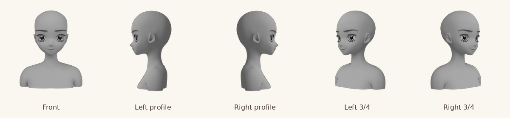

# 用意したあたりの出典と作成方法

## 現在の素材

M14追補で、自作の簡易パス図を、ネット上で公開されている **MB-Lab / ManuelBastioniLABのアニメ調素体**を元にした2D下絵へ差し替えた。既存の2D素材をそのままダウンロードしたものではなく、公開されている3D素材の顔・首・肩・胸上部を、利用が認められた2D画像としてレンダリングしたもの。AI画像生成は使っていない。



- 配布元：[animate1978/MB-Lab](https://github.com/animate1978/MB-Lab)
- 使用版：`063bff04e60f3e7c651fda628c30f5d83f3f3078`
- 著作者の表示：Manuel Bastioni、MB-Lab contributors
- 使用モデル：`data/humanoid_library.blend`内の`MBLab_anime_female`
- 使用した追加データ：同梱の関節位置・腕のウェイト・目のテクスチャ。外部のキャラクター素材や第三者の参考画像は使わない。
- 配布元の[利用条件](https://github.com/animate1978/MB-Lab/blob/063bff04e60f3e7c651fda628c30f5d83f3f3078/license.txt)と、取得時点の[利用条件の写し](../third_party/MB-Lab-LICENSE.txt)

## 利用条件の判断

元の3DデータベースはAGPL 3であり、CC0素材とは表示しない。一方、同じ利用条件の **LICENSE OF RENDERS GENERATED BY THE SOFTWARE.** では、通常のシーンをレンダリングした2D画像・動画は元データベースの派生物とは扱わず、2D画像の作者が利用・ライセンスを決め、商用プロジェクトにも利用できることが明記されている。

> Rendered two-dimensional images or two-dimensional videos of a scene that includes 3D models generated with ManuelbastioniLAB are not considered a derived product of the licensed 3D database and 3D base models.

> Also the author of the 2D rendering can use any license for the two-dimensional image/video created by him and of course he can use his two-dimensional image/video for commercial projects.

今回の画像は、素体を立体として配置し、カメラ・照明・陰影・輪郭線を使って描画した通常の人物シーン。テクスチャを平面へ貼って元データを抽出する用途ではない。アプリへ同梱・配信するのは完成したPNGだけで、元の3Dモデル、データベース、アドオンのプログラムは含めない。

本アプリが用意したこの2D下絵は、利用者の模写・トレース、描き換えと、それらから描いた作品の公開に無料で使える。キャラクターや別途持ち込んだ画像の権利・利用条件はこの許可と別であり、利用者自身で確認する。元3Dデータのライセンスを書き換えたり、アプリ全体や利用者の作品をAGPLと指定したりはしない。

## 加工と同梱

顔・耳・目鼻口、首、肩、胸の上までを表示する。腕を元の関節位置とウェイトで下げ、胸上部で切り、髪・衣装を付けず、グレースケール・透明背景・輪郭線と陰影で出力した。顔や体つきは1つの見本で、目・口・髪・服・体格は利用者が自由に描き換えられる。

Blender 4.3.2のCycles、960×960px、256サンプルで、正面・右横顔・右斜め45度を作成した。左横顔・左斜めはそれぞれの左右反転とし、プレビューと実際の下絵を同じ向きにする。左右は画面上で顔が向く方向。

完成画像3枚は[同梱素材](../src/assets/guide-presets/)に置く。選択一覧は320pxの軽いプレビュー3枚（合計約75KB）を使い、960px画像（各約324〜349KB）は選んだときだけ同じサイトから読み込む。Viteがサブパスに対応する配信URLを作る。利用時に配布元・CDNへ接続せず、作品や参考画像を送信しない。通常の開発・ビルドにBlenderやPythonは不要。

新しい作品／選び直しには新素材を使う。保存済みの下絵は独立したPNGとして保持し、自動で交換しない。制作中の入替には従来の確認があり、本人の線・レイヤーは残る。DB v5・ZIP v3の移行は不要。

## 再作成する場合だけの手順

Blender 4.3.2、Python 3、Pillow、DejaVu Sansフォントが必要。取得元URLとSHA-256は[固定ソース一覧](../scripts/guide-sources.json)に記録した。各ファイルを取得して任意の作業ディレクトリへ同名で置き、ハッシュを検証する。アプリの利用者がこれを行う必要はない。

```sh
blender --background --factory-startup --disable-autoexec \
  --python scripts/render-guide-assets.py -- \
  --source-dir /tmp/guide-sources --output-dir /tmp/guide-renders
python3 scripts/package-guide-assets.py --source-dir /tmp/guide-renders
```

自作の[レンダリング処理](../scripts/render-guide-assets.py)は素材のハッシュを照合し、必要なメッシュだけをデータとして読む。配布元のPythonコードやblend内の自動実行スクリプトは動かさない。[梱包処理](../scripts/package-guide-assets.py)でPNGを可逆圧縮し、プレビューと上記の一覧画像を作る。新しい素材へ変更する場合も、同梱・加工・利用者による公開まで許される条件か確認し、取得版・加工・画像を更新して5方向を目視する。自動テストの画素検査だけで、絵の使いやすさを合格扱いにしない。
