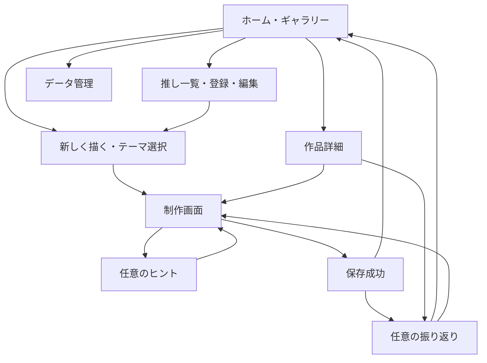

# 画面遷移とユーザー体験

## 全体の流れ

## 画面一覧

| 画面・URL例 | 内容と操作 | 条件 |
| --- | --- | --- |
| ホーム `#/` | 作品一覧、推し絞込、新しく描く、続きから、推し管理、データ管理 | 登録・講座は必須にしない |
| 推し一覧 `#/characters` | 選択・追加・編集・切替 | 複数の推しを保存可能 |
| 推し編集 `#/characters/new`、`#/characters/:id` | 名前、参考画像、好きな特徴メモ、保存 | 名前必須、画像・メモは任意 |
| テーマ `#/new` | 推し、4カテゴリ、自由入力、候補3件以下、再提案、画像から開始 | テーマ空欄・推し未選択でも開始可能 |
| 制作 `#/draw/:id` | キャンバス、道具、参考画像、テーマ、ヒント、保存状態 | 途中でも保存・終了可能 |
| 作品詳細 `#/works/:id` | 絵、テーマ、日付、状態、振り返り、再開、書出、削除 | ひと区切りの作品も再開可能 |
| データ管理 `#/settings/data` | 容量、端末内保存の説明、バックアップ・追加復元、全消去 | 復元・破壊操作は結果を事前提示 |

存在しないIDは説明とホームへ戻る導線を出す。ブラウザーの戻るも未保存保護の対象にし、履歴を無限に追加しない。

## 初回体験

1. 空のホームに「好きなキャラクターを描いてみる」「自由に落書きする」を表示する。
2. 「このブラウザーに保存されます。大切な絵は書き出してください」と短く伝え、詳細説明は任意で開く。
3. 推し登録は名前だけでも進める。画像選択時に端末内保存と利用条件を案内する。
4. お題で迷えば少数の候補を出す。「あとで決める」でも制作へ進める。
5. 制作画面の「線をひとつ描いてみる」「ヒントを見る」は閉じられる案内とし、練習を強制しない。

## 制作画面

縦画面は上部に戻る・テーマ・保存状態、中央にキャンバス、下部に主要道具。参考画像とヒントは開閉式にし、小さい参照画像を見ながら描ける。PCでは横に参照領域を配置できる。

Pointer Eventsで単一ポインターを追跡し、pointer captureで枠外への移動を扱う。pointercancelでは線を終了して保存へ進む。2本目の指で線を追加しない。キャンバスだけに`touch-action: none`を適用し、周囲のスクロール・ページ拡大を保つ。手のひら誤入力は実機で検証する。

CSS表示サイズと保存解像度を分け、画面回転・リサイズで絵を消さない。色には名称、線幅には数値を付ける。取り消し履歴がないときはボタンを無効にし、状態を伝える。

## 保存・終了・再開

自動保存の作品は「途中」として一覧に残る。「途中で保存」は振り返りなしで終了できる。「ひと区切り」は保存成功後に任意の振り返りを1問だけ表示する。「スキップ」で終了、「もう1問」で追加する。

回答に評価を返さず、空回答や否定的回答も受け入れる。後日作品詳細から回答・編集・削除できる。ホームの「続きから」は最後の保存状態を開く。再開時に以前の取り消し履歴が戻らないことを説明する。明示的な空の作品保存も認める。

## エラーと回復

| 状況 | 回復動作 |
| --- | --- |
| 容量不足・保存失敗 | 未保存を明示。編集中の絵を保持し、再試行・PNG書出。既存作品を自動削除しない |
| DB利用不可 | 一時描画と書出に限定。再読込で失うことを明示 |
| 画像が不正・大きい・未対応 | 理由と条件を示し、選択し直す。既存画像を保持 |
| 複数タブ競合 | 上書きを止め、再読込／別作品保存 |
| 不正なバックアップ | 既存データを変えず取込を中止 |
| 未保存の離脱 | 保存を試し、失敗時は留まる／破棄を選択。OS強制終了の完全保護は保証しない |

## アクセシビリティと文言

シートはフォーカスを管理し、Escapeで閉じ、元の操作へ復帰する。入力エラーは項目に関連付け、保存状態は控えめなライブ領域で通知する。ストロークごとの過剰な読み上げは避ける。ショートカットは入力欄で発火させず、同じ操作のボタンも提供する。

「残念」「もっと頑張ろう」「昨日より上手」などの評価を使わない。過去作品との比較は本人が希望したときだけ。自由描画はポインター前提という制約を明記し、取込からも創作フローに参加できるようにする。

## M2の実装済み導線

推し一覧の「推しを登録する」→名前・任意メモ・任意参考画像→「登録して保存」→一覧の「保存しました」が基本。登録だけでは選択を強制せず、各カードの「この推しを選ぶ」で切り替える。「編集する」で内容を変更し「変更を保存」。選択中の推しは再読み込み後も保持する。

「参考画像を外す」は編集内容として反映し、保存するまで元の画像を削除しない。未対応・破損画像を選んでも前の画像と入力を保持する。削除は「この推しを削除」→対象名を含む確認シート→「削除する」。閉じる／Escapeでキャンセルできる。

保存エラー時は一覧へ遷移せず、入力と画像を残して理由を表示する。別タブの編集と競合した場合も無言で上書きしない。テーマ準備画面には選んだ推しの名前と「推しを選び直す」を表示する。お題・描画・振り返りはまだ準備中。
