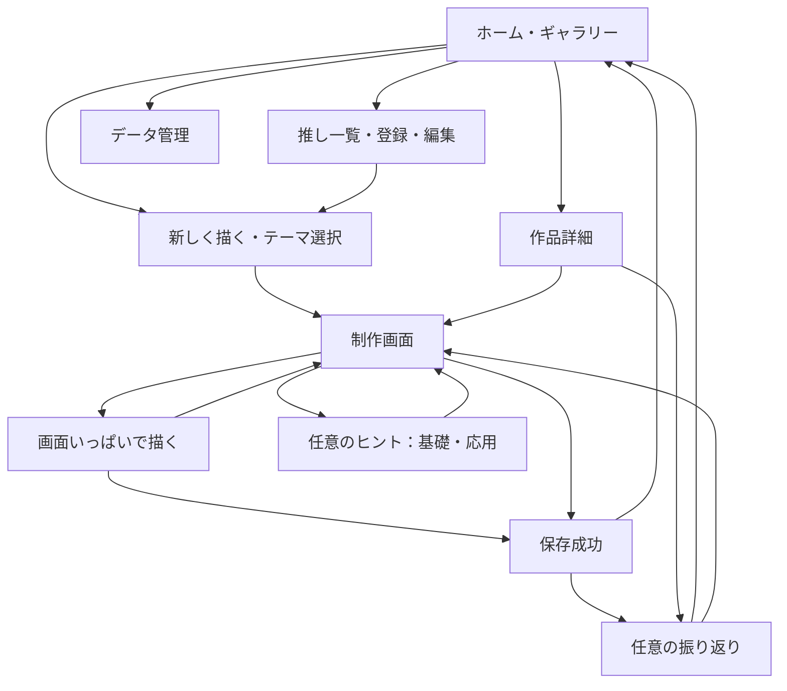

# 画面遷移とユーザー体験

## 全体の流れ

## 画面一覧

| 画面・URL例 | 内容と操作 | 条件 |
| --- | --- | --- |
| ホーム `#/` | 作品一覧、推し絞込、新しく描く、続きから、推し管理、データ管理 | 登録・講座は必須にしない |
| 推し一覧 `#/characters` | 選択・追加・編集・切替 | 複数の推しを保存可能 |
| 推し編集 `#/characters/new`、`#/characters/:id` | 名前、参考画像、好きな特徴メモ、保存 | 名前必須、画像・メモは任意 |
| テーマ `#/new` | 推し、4カテゴリ、自由入力、候補3件以下、再提案、画像から開始 | テーマ空欄・推し未選択でも開始可能 |
| 制作 `#/draw/:id` | キャンバス、道具、参考画像、テーマ、ヒント、保存状態 | 途中でも保存・終了可能 |
| 作品詳細 `#/works/:id` | 絵、テーマ、日付、状態、振り返り、再開、書出、削除 | ひと区切りの作品も再開可能 |
| データ管理 `#/settings/data` | 容量、端末内保存の説明、バックアップ・追加復元、全消去 | 復元・破壊操作は結果を事前提示 |

存在しないIDは説明とホームへ戻る導線を出す。ブラウザーの戻るも未保存保護の対象にし、履歴を無限に追加しない。

## 用意した顔から胸元のあたり（M14）

素材差し替え後も操作は同じ。MB-Labの公開素体を元にした2D画像と、下絵として使える旨・出典を選択欄に表示する。保存済み作品の下絵を更新する場合は、本人が5種類から選び直して入替を確定する。[出典と一覧](GUIDE_ASSETS.md)を参照。

新規：新しく描く→「下絵をなぞって描く」→「用意したあたり（5種類）」→向きのプレビュー付きボタン→「この下絵で描きはじめる」。推しや参考画像、テーマを登録していなくても使える。白紙は引き続き初期選択。

制作中：通常／専用画面の「描くサポート」→「下絵をなぞる」→「正面を使う」「左横顔を使う」「右横顔を使う」「左斜めを使う」「右斜めを使う」。左右は画面上で向く方向。既存の下絵があれば入替確認が出る。取消なら戻り、確定でも本人の線は残す。画像を使う場合は同じ設定内の「自分の画像を使う」へ進む。

選択後は濃さ・表示／非表示を調整し、「閉じる」で制作へ戻る。途中保存→再読み込みで下絵と設定を復元する。PNGは本人の線だけ、下絵も残す場合は全データZIPを使う。

「描くヒント（任意）」→基礎→「顔の形」に選び方がある。「模写」「トレース」には、それぞれ何の練習になるかと公開前の短い注意がある。閲覧や回答を描画の条件にしない。

## 描くヒント（M13）

制作画面→「描くヒント（任意）」→「基礎／応用」→読みたい項目。初期は基礎の表情で、応用も最初から自由に選べる。基礎は表情・顔の形・簡単なポーズ・模写・トレース、応用はレイヤー・拡大回転・模写とトレースの違いと注意点。図解・短文・方法の比較で説明する。

区分を切り替えても、それぞれで選んだ項目は開いている間は残る。「閉じる」「描く画面に戻る」またはEscapeで、同じ絵・道具・下絵・取消履歴と入口へのフォーカスへ戻る。開き直すと基礎の表情から表示する。読了を条件にせず、一時描画でも読める。通常の講座・教材の順序や達成記録は設けない。

## 初回体験

1. 空のホームに「好きなキャラクターを描いてみる」「自由に落書きする」を表示する。
2. 「このブラウザーに保存されます。大切な絵は書き出してください」と短く伝え、詳細説明は任意で開く。
3. 推し登録は名前だけでも進める。画像選択時に端末内保存と利用条件を案内する。
4. お題で迷えば少数の候補を出す。「あとで決める」でも制作へ進める。
5. 制作画面の「線をひとつ描いてみる」「ヒントを見る」は閉じられる案内とし、練習を強制しない。

## 制作画面

M12ではキャンバスの前に「描くサポート」を置き、「下絵をなぞる」「レイヤー」「拡大・回転」の3つのアイコン付きボタンを並べる。通常画面と専用画面で同じ入口を使える。下絵の状態・レイヤー枚数も確認できる。ボタンを押すと該当する設定だけが開き、「閉じる」やEscapeで入口へ戻る。開閉で描いた画像・表示変換・選択先・取消履歴を作り直さない。

レイヤーは任意。初期1枚のままでも描ける。「レイヤー」→追加→描く1枚を選ぶ→その1枚へ描画・消しゴム、という流れで最大5枚まで使える。

リストは上が手前。「隠す／表示する」「上へ／下へ」「削除」を使え、削除は対象名を示して確認する。1枚未満や6枚以上にはできない。非表示の選択先には線を追加せず、道具近くの「表示して描く」で戻る。追加・削除・表示・順序も取り消せる。

保存→再読み込みで選択先・重なり・非表示も戻る。PNGは表示分だけを合成し、分けた状態と非表示も残すには全データZIPを使う。ヒントや振り返りを開く条件にはしない。

縦画面は上部に戻る・テーマ・保存状態、中央にキャンバス、下部に主要道具。参考画像とヒントは開閉式にし、小さい参照画像を見ながら描ける。PCでは横に参照領域を配置できる。

M8のなぞり描きは、新しく描く→「描きはじめ方：下絵をなぞって描く」→推しの参考画像／端末の画像→「この下絵で描きはじめる」→制作。テーマ欄まで進んで入力してもよく、空欄のままでもよい。薄い下絵を目印に指で描く。顔や好きな部分だけで終了してもよい。現在は描く画面の「下絵をなぞる」ボタンからも選び直し・濃さ調整・解除ができる。「下絵を隠す」で線だけを確認し、「下絵を表示する」で戻る。

消しゴム・取り消しは本人の線に作用し、下絵を消さない。途中保存→再読み込み／続きからで線と下絵設定に復帰する。PNG・作品サムネイルは線だけを白背景で出す。下絵も残すには全データのZIPを使う。紙や他アプリの絵への加筆は従来の「紙や他のアプリの絵を取り込む」で、下絵として置く操作とは区別する。

道具はキャンバスの直後に置き、通常文字のスマートフォンではペン・消しゴム・取り消しを横並びにする。色・線幅→途中保存／PNG書出→操作説明→任意のヒント・振り返りの順。文字を大きくしたときは道具を折り返し、同じ順序でスクロール・キーボード操作できる。参考画像や長いテーマを閉じる／変更することを描画の条件にしない。

Pointer Eventsで追跡し、キャンバスの表示枠がpointer captureを持つ。通常は1本指で描き、2本目が加わったら描きかけの1ストロークを戻して、2本指の拡大・縮小・回転・移動へ切り替える。完了済みの線と取り消し履歴は残す。片方の指を離しても描画を再開せず、すべて離した後の1本指から描く。単独の描画中のpointercancelではその線を終了して保存へ進み、表示操作の取消では線を追加しない。表示枠だけに`touch-action: none`を適用し、周囲のスクロール・ページ拡大を保つ。手のひら誤入力は実機で検証する。

「拡大・回転・移動」は初期状態では閉じ、開くと倍率・角度、拡大縮小・左右回転・「表示を戻す」のボタンが出る。「表示を動かす」では1本指・マウスで移動し、「描く」で戻る。移動モードで表示枠へフォーカスすると矢印キーも使える。表示範囲は50〜800%、2本指では自由回転、ボタンは左右15度刻み。下絵と線を一緒に動かし、保存・PNGは元の960pxの向きを保つ。表示を戻す／画面を開き直すと全体表示へ戻る。

CSS表示サイズと保存解像度を分け、画面回転・リサイズで絵を消さない。色には名称、線幅には数値を付ける。取り消し履歴がないときはボタンを無効にし、状態を伝える。

## M10の専用描画画面

制作画面→「画面いっぱいで描く」→画面に収まるキャンバス→「通常画面に戻る」→元の制作画面。専用画面では通常のメニューやテーマを背景に退け、キャンバス・必要な道具・保存状態を表示する。

1本指で描画し、2本指で拡大・回転・移動する。現在は上部の「描くサポート」から下絵・レイヤー・拡大回転を直接開く。「道具設定」で色・線幅・PNG書き出しを開き、「設定を閉じる」で戻る。設定は1種類ずつ開き、その枠内をスクロールできる。余白や上部に触れても背景ページは動かない。

「通常画面に戻る」／Escapeは専用画面だけを閉じる。同じCanvasが残り、線・下絵・取り消し・倍率・回転・道具を維持する。通常画面へ戻るとスクロール位置と開始ボタンへ戻る。ヒント・質問は通常画面から本人が選ぶ。

画面の縦横に合わせてCanvasの表示寸法を調整し、保存画像の960pxは保つ。ページ再読込は通常画面・全体表示から開く。保存不足は専用画面でも表示し、描いた線を残して再試行や道具設定からのPNG書き出しへ進める。

## 保存・終了・再開

新規作品は「途中」として一覧に残る。「途中で保存」は質問を開かず絵を保存する。作品詳細の「ひと区切りにする」は状態だけを変更し、振り返りを強制しない。「振り返る（任意）」または詳細の「振り返りを見る・書く（任意）」で1問だけ開く。「この質問をスキップ」で次の通常質問へ進み、「振り返りを終える」で閉じる。保存後は「もう1問（任意）」を押した場合だけ質問を追加する。

回答に評価を返さず、空回答や否定的回答も受け入れる。後日作品詳細から回答・編集・削除できる。ホームの「続きから」は最後の保存状態を開く。再開時に以前の取り消し履歴が戻らないことを説明する。明示的な空の作品保存も認める。

## エラーと回復

| 状況 | 回復動作 |
| --- | --- |
| 容量不足・保存失敗 | 未保存を明示。編集中の絵を保持し、再試行・PNG書出。既存作品を自動削除しない |
| DB利用不可 | 一時描画と書出に限定。再読込で失うことを明示 |
| 画像が不正・大きい・未対応 | 理由と条件を示し、選択し直す。既存画像を保持 |
| 複数タブ競合 | 上書きを止め、再読込／別作品保存 |
| 不正なバックアップ | 既存データを変えず取込を中止 |
| 未保存の離脱 | 保存を試し、失敗時は留まる／破棄を選択。OS強制終了の完全保護は保証しない |

## アクセシビリティと文言

シートはフォーカスを管理し、Escapeで閉じ、元の操作へ復帰する。入力エラーは項目に関連付け、保存状態は控えめなライブ領域で通知する。ストロークごとの過剰な読み上げは避ける。ショートカットは入力欄で発火させず、同じ操作のボタンも提供する。

「残念」「もっと頑張ろう」「昨日より上手」などの評価を使わない。過去作品との比較は本人が希望したときだけ。自由描画はポインター前提という制約を明記し、取込からも創作フローに参加できるようにする。

## M2の実装済み導線

推し一覧の「推しを登録する」→名前・任意メモ・任意参考画像→「登録して保存」→一覧の「保存しました」が基本。登録だけでは選択を強制せず、各カードの「この推しを選ぶ」で切り替える。「編集する」で内容を変更し「変更を保存」。選択中の推しは再読み込み後も保持する。

「参考画像を外す」は編集内容として反映し、保存するまで元の画像を削除しない。未対応・破損画像を選んでも前の画像と入力を保持する。削除は「この推しを削除」→対象名を含む確認シート→「削除する」。閉じる／Escapeでキャンセルできる。

保存エラー時は一覧へ遷移せず、入力と画像を残して理由を表示する。別タブの編集と競合した場合も無言で上書きしない。テーマ準備画面には選んだ推しの名前と「推しを選び直す」を表示する。（M2時点はお題・描画・振り返りが準備中。M4の現在の導線は末尾参照。）

## M3の実装済み導線

`#/new`で今回描くキャラクターを選択→カテゴリを選択→候補を選ぶ／再提案／自由入力→「このテーマで進む」が基本。候補は3件以下。カテゴリを変えても入力テーマは残す。推しを選ばない、テーマを空欄にする、「テーマを決めずに進む」のいずれも可能。

保存成功後は`#/draw/:id`でキャラクターとテーマを表示する。M3時点は制作準備画面のみ。M4で実キャンバスへ置き換えた。ホームの再開ボタン（M4では「続きから描く」）で、最後に開いた準備へ戻る。再読み込みでも同じIDのデータを読むだけで、準備データを重複作成しない。

準備画面の「別のテーマで準備する」は新しい準備へ進む導線で、前の準備を消さない。準備データの一覧・削除はM6の範囲。

別タブの推し変更はフォーカス復帰時に選択肢へ反映する。削除された推しを選んでいた場合は説明を出し、入力済みテーマを保ったまま選び直せる。保存失敗では移動せず、入力と既存データを保持する。

## M4の実装済み導線

1. 推し・テーマを選択（未選択・空欄も可）→「このテーマで進む」または「テーマを決めずに進む」→実キャンバス。旧準備データも同じURLで白紙から描ける。
2. 指・ペン・マウスで描く。道具はキャンバスの下。ペン／消しゴム・色・線幅を変更し、直前の9操作を取り消せる。保存状態の変更でキャンバスが上下へ移動しない。
3. 参考画像があれば「参考画像を見る／閉じる」。画像はキャンバス外に表示し、作品の絵へ混ぜない。
4. 描くのを止めて約1秒待つ、または「途中で保存」→「保存済み」。白紙の保存も可能。ホームへ戻るときも未保存分の保存を待つ。失敗時は画面に留まる／破棄を本人が選ぶ。
5. ホームの「続きから描く」→最後に開いた作品を再開。再読込でも画像・テーマ・推し・道具を復元する。取り消し履歴は再開時に戻らない。全作品一覧はM6で追加予定。
6. 「紙や他のアプリの絵を取り込む」→端末画像を選択→元作品を残して別作品を開く。比率を保って正方形へ収め、続きを描ける。不正・非対応画像なら元の画面を保持する。
7. 「PNGを書き出す」→白背景960px画像をダウンロード。「画像を開く」、対応環境の「端末の機能で共有する」も選べる。参考画像・テーマ・操作UIは出力へ含めない。

容量不足では今の絵を保持し、保存再試行・PNG・別作品保存の導線を出す。別タブとの競合では上書きを止め、コピーによる救済保存が可能。壊れた保存画像は、白紙で自動上書きしないよう編集を止める。

DBが使えない場合もホームの「保存せずに落書きを試す」から`#/draw/new`へ入れる。一時描画とPNG出力のみで、再読み込みすると消えることを明示する。

M4時点ではヒント・振り返り・「ひと区切り」・作品一覧は未実装。M5の導線は以下を参照。

## M5の実装済み導線

- 制作画面→「描くヒント（任意）」→種類から選ぶ→「描く画面に戻る」／閉じる／Escape。同じキャンバス・道具・取消履歴に戻る。M5導入時は3種類で、現在はM13の基礎・応用へ拡張している。受講は描画や保存の条件にしない。
- 制作画面→「振り返る（任意）」→絵の保存成功→途中作品の質問を1問だけ表示。保存失敗なら制作画面を保つ。通常の「途中で保存」・自動保存だけでは質問を表示しない。
- 選択肢・文章・空欄→「回答を保存」→「保存しました」と過去回答を表示。続きの質問は自動表示しない。「この質問をスキップ」なら回答を作らず次の未表示の通常質問へ進む。最後は「用意した質問はここまでです」と回答一覧を表示し、勝手に閉じない。「振り返りを終える」で元画面へ戻る。
- 「もう1問（任意）」を選んだ場合だけ未表示の質問へ。比較は通常質問と分け、同じ推しの過去作品がある場合に「前の作品との違いを考える（任意）」を表示。押すと比較先の選択と前の作品画像を開く。
- 再開後に「振り返る（任意）」→保存済み回答→「回答を編集」→明示保存。「回答を削除」→質問を表示した確認→削除／キャンセル。作品画像を変更しない。
- 未保存の回答がある状態の閉じる・Escape・Backでは破棄を確認。キャンセルなら入力と制作を保持。閉じたときのフォーカスは開いたボタンへ戻す。

回答の容量不足・競合では、保存済みの絵と入力を保持する。再試行、明示的な一覧再読み込み、入力を控える案内を用意する。回答が不正でも勝手に削除せず、シートを閉じて描画を続けられる。

## M6の実装済み導線

1. ホーム「あなたの作品」→推し・状態で絞り込み→作品カード。12件を超えたら「前の作品」「次の作品」で切り替える。上部の「新しく描く」は作品が増えても利用できる。
2. 作品詳細→絵・テーマ・日付・メモを確認→「続きを描く」、または「PNGを書き出す」。制作画面の「作品の詳細を見る」からも戻れる。
3. 「ひと区切りにする」／「途中に戻す」は状態だけを変更。「振り返りを見る・書く（任意）」から保存済みの回答を閲覧・編集・削除する。質問なしでも作品は残る。
4. 「この作品を削除」→作品名入り確認→削除／キャンセル。確定後はホームへ。別作品の比較メモは残し、削除された前の絵を自動で復元しない。
5. データ管理→「全データをバックアップ」→端末へZIP保存。ダウンロードに制約があれば「ZIPをダウンロード」も使う。参考画像・メモ・回答を含むことを画面で説明する。
6. 「バックアップZIPを選ぶ」→保存前検証→日時と件数の「追加する内容」→「この内容を追加する」／「復元をキャンセル」。既存データへ追加し、同じZIPの再追加は複製になる。
7. 「このブラウザーの全データを削除」→対象説明→確認文を入力→「全データを削除する」。キャンセル・途中失敗ではデータを変更しない。

競合で状態変更・削除が止まったら「最新の内容を読み直す」を使う。制作中なら「最新の保存を読み直す」で未保存分の破棄を確認するか、「今の絵を別の作品として保存」で残す。バックアップ・追加復元・全消去の処理中は画面に留まる。

## M7の表示と端末確認

スマートフォン・iPad相当の縦横・狭いウィンドウでも同じ導線を使う。文字拡大時は見出しや道具も拡大し、長い名前・テーマは折り返す。画面幅を変更しても保存解像度960pxは変えず、絵を初期化しない。短い表示高さではシート内をスクロールして回答・保存・終了を操作する。

iPad実機のSafari、Apple Pencil、実ソフトキーボード、PNG／ZIPの端末保存は[実機確認表](DEVICE_CHECKLIST.md)の手順で確認する。同じURLでもスマホとiPadは別の保存領域で、自動同期しない。移行は元の端末でZIPを書き出し、移行先で内容確認後に追加復元する。
